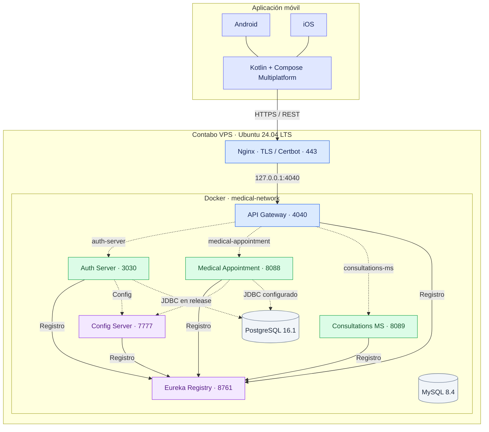
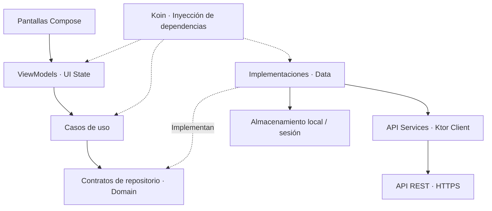

# MedicalApp

**Sistema móvil multiplataforma para la gestión de citas médicas**


## Descripción

MedicalApp es una aplicación móvil multiplataforma orientada a la gestión de citas médicas. Permite administrar pacientes, médicos, especialidades y horarios de atención, así como programar y gestionar citas según el rol de cada usuario.

La solución integra un cliente móvil desarrollado con Kotlin y Compose Multiplatform y un backend distribuido desplegado mediante contenedores Docker en un VPS de Contabo. La comunicación con los servicios remotos se realiza mediante una API REST accesible a través de HTTPS.

Este repositorio está orientado al cliente móvil y su integración con el backend. Otros clientes desplegados en la infraestructura quedan fuera del alcance de esta documentación.

## Funcionalidades

| Módulo | Funcionalidades |
| --- | --- |
| Autenticación | Inicio de sesión, registro y gestión de sesión mediante JWT. |
| Usuarios | Administración de usuarios y acceso diferenciado por roles. |
| Pacientes | Consulta, búsqueda y mantenimiento de pacientes. |
| Médicos | Consulta, búsqueda y mantenimiento de médicos. |
| Especialidades | Administración de especialidades médicas. |
| Horarios | Configuración y gestión de horarios de atención. |
| Citas | Programación, consulta, confirmación, cancelación y finalización según permisos. |
| Agenda | Calendario de citas y agenda del médico. |
| Dashboard | Resumen de información según el rol del usuario. |

### Roles

| Rol | Responsabilidades principales |
| --- | --- |
| `ADMIN` | Gestionar usuarios, pacientes, médicos, especialidades, horarios y citas. |
| `DOCTOR` | Consultar su agenda y completar las citas asignadas según el estado correspondiente. |
| `PATIENT` | Registrar, consultar y cancelar sus propias citas según las reglas del sistema. |

## Arquitectura general

La aplicación móvil consume los servicios mediante el dominio público `https://alexguevara.dev`. Nginx recibe las solicitudes HTTPS y las dirige al API Gateway, cuyo puerto está publicado únicamente en la interfaz local del VPS. Los microservicios y las bases de datos se encuentran en una red Docker compartida.



**Lectura del diagrama:** las líneas continuas representan el acceso público y los registros observados en Eureka; las discontinuas representan rutas lógicas o relaciones declaradas en la configuración, cuya implementación efectiva no se ha comprobado íntegramente. MySQL permanece desplegado, pero su uso actual no está confirmado. No se representa una comunicación directa de Consultations MS con otro servicio porque la dependencia de arranque no demuestra una llamada de red.

## Tecnologías

| Área | Tecnologías |
| --- | --- |
| Cliente móvil | Kotlin Multiplatform, Compose Multiplatform, Material 3 |
| Comunicación y dependencias | Ktor Client, Koin, Kotlinx Serialization |
| Compilación móvil | Gradle Wrapper (9.5.0) |
| Backend | Java, Spring Boot, Maven |
| Infraestructura distribuida | Spring Cloud Gateway, Netflix Eureka, Spring Cloud Config |
| Autenticación | JWT y control de acceso por roles |
| Persistencia desplegada | PostgreSQL 16.1, MySQL 8.4 |
| Despliegue | Docker, Docker Compose, Nginx, Certbot, Ubuntu, Contabo VPS |

## Arquitectura del frontend

El módulo `shared` organiza el código mediante una arquitectura por capas. Los módulos `androidApp` e `iosApp` proporcionan los puntos de entrada específicos de cada plataforma.



| Capa | Responsabilidad |
| --- | --- |
| `presentation` | Pantallas, navegación, componentes, ViewModels y estado de interfaz. |
| `domain` | Modelos, casos de uso y contratos de repositorios. |
| `data` | Implementaciones de repositorios, DTO, mappers, servicios remotos y almacenamiento local. |
| `di` | Configuración de la inyección de dependencias. |

## Backend e infraestructura

| Componente | Puerto interno | Responsabilidad |
| --- | ---: | --- |
| API Gateway | 4040 | Punto de entrada a las APIs de los microservicios. |
| Auth Server | 3030 | Servicio de autenticación. |
| Medical Appointment | 8088 | Gestión de citas y recursos médicos. |
| Consultations MS | 8089 | Servicio de consultas médicas. |
| Registry Server | 8761 | Registro y descubrimiento de servicios mediante Eureka. |
| Config Server | 7777 | Configuración centralizada de servicios. |
| PostgreSQL | 5432 | Persistencia médica; también configurado para Auth Server en la composición release. |
| MySQL | 3306 | Base de datos desplegada; utilización efectiva pendiente de verificar. |

### Acceso a la API

URL base: `https://alexguevara.dev`

| Prefijo público | Destino de Nginx |
| --- | --- |
| `/auth-server/` | API Gateway |
| `/medical-appointment/` | API Gateway |
| `/consultations-ms/` | API Gateway |

Estas rutas corresponden a los prefijos configurados en el proxy inverso; no constituyen un catálogo completo de endpoints ni implican que todas sean consumidas por la aplicación móvil.

### Despliegue

- VPS Contabo con Ubuntu 24.04 LTS, 4 vCPU y aproximadamente 8 GiB de RAM.
- Nginx y Certbot para el acceso HTTPS.
- API Gateway publicado en la interfaz loopback del servidor.
- Microservicios y bases de datos sin puertos publicados directamente hacia Internet.
- Red Docker de tipo bridge: `medical-app_medical-network`.
- Persistencia mediante volúmenes Docker para PostgreSQL y MySQL.

La infraestructura utiliza configuraciones Docker Compose de base y release. En esta última se declara una conexión PostgreSQL para Auth Server y Medical Appointment. Las credenciales y secretos deben gestionarse fuera del código fuente. No se incluyen configuraciones sensibles de producción en este README.

## Estructura del repositorio

```text
medical-app/
├── backend/                   # Submódulo: Medical Appointment
├── frontend/
│   ├── androidApp/            # Aplicación Android
│   ├── iosApp/                # Aplicación iOS
│   ├── shared/
│   │   └── src/
│   │       ├── commonMain/    # Código compartido
│   │       ├── commonTest/    # Pruebas compartidas
│   │       ├── androidMain/   # Implementaciones Android
│   │       ├── androidHostTest/
│   │       ├── iosMain/       # Implementaciones iOS
│   │       └── iosTest/
│   ├── gradle/
│   ├── .gitignore
│   ├── build.gradle.kts
│   ├── gradle.properties
│   ├── gradlew
│   ├── gradlew.bat
│   └── settings.gradle.kts
├── .gitignore
├── .gitmodules
└── README.md
```

El directorio `backend/` referencia específicamente el repositorio [medical_appointment](https://github.com/Desarrollo-Aplicaciones-Distribuidas/medical_appointment). No contiene necesariamente los demás microservicios ni toda la infraestructura de producción, que se mantienen en repositorios independientes.

## Instalación y ejecución

### Requisitos

- Git y acceso al repositorio del submódulo.
- Android Studio, Android SDK y JDK compatible con la configuración Gradle del proyecto.
- Emulador o dispositivo Android.
- Para iOS: macOS, Xcode y un simulador o dispositivo compatible.

### 1. Clonar el proyecto

```bash
git clone --recurse-submodules https://github.com/Moviles-MedicalApp/medical-app.git
cd medical-app
```

Si ya se clonó sin submódulos:

```bash
git submodule update --init --recursive
```

### 2. Configurar la conexión al backend

El archivo [`ApiConstants.kt`](frontend/shared/src/commonMain/kotlin/pe/com/smart/data/remote/api/support/ApiConstants.kt) contiene la configuración de la API del cliente móvil. Ajustar la URL base únicamente si se desea utilizar otro entorno de backend.

El entorno desplegado documentado utiliza `https://alexguevara.dev`. No es necesario instalar los microservicios localmente para usar el cliente con ese entorno, siempre que esté disponible y se cuente con las credenciales de usuario correspondientes.

### 3. Ejecutar en Android

Abrir la carpeta `frontend/` en Android Studio, sincronizar Gradle y ejecutar el módulo `androidApp`.

Compilación de depuración desde `frontend/` en Windows:

```powershell
.\gradlew.bat :androidApp:assembleDebug
```

Linux o macOS:

```bash
./gradlew :androidApp:assembleDebug
```

### 4. Ejecutar en iOS

Desde macOS, abrir `frontend/iosApp/iosApp.xcodeproj` con Xcode, configurar el destino y compilar. Las pruebas y compilaciones del simulador iOS requieren macOS.

### 5. Backend local

Para trabajar con Medical Appointment, consultar su [repositorio original](https://github.com/Desarrollo-Aplicaciones-Distribuidas/medical_appointment). La reproducción del despliegue completo requiere adicionalmente los repositorios de Gateway, Auth Server, Consultations MS, Registry Server, Config Server y sus configuraciones de infraestructura. Clonar este repositorio no instala automáticamente todo el backend distribuido.

## Pruebas y validación

Desde la raíz del repositorio:

```bash
bash frontend/gradlew -p frontend projects
```

Esta comprobación fue ejecutada satisfactoriamente en GitHub Codespaces tras reorganizar el frontend. Gradle reconoció el proyecto `MedicalApp` y los módulos `:androidApp` y `:shared`.

Para consultar las tareas de prueba disponibles:

```bash
cd frontend
./gradlew :shared:tasks --all
```

El repositorio contiene pruebas compartidas, Android e iOS. La comprobación de configuración no sustituye una compilación completa ni la ejecución de la suite de pruebas.

## Gestión del submódulo

Consultar la versión del backend vinculada:

```bash
git submodule status
```

Actualizar el repositorio y descargar la versión registrada:

```bash
git pull --ff-only origin main
git submodule update --init --recursive
```

Para incorporar una versión posterior del backend, revisar primero los cambios y luego registrar la nueva referencia:

```bash
git submodule update --remote backend
git diff --submodule=log
git add backend
git commit -m "chore: update backend submodule reference"
git push origin main
```

El submódulo conserva su propio historial y el repositorio principal fija un commit concreto para mantener el control de versiones.

## Seguridad

La aplicación utiliza gestión de sesión y autenticación mediante JWT, con interfaces diferenciadas por roles. La autorización efectiva de cada operación debe aplicarse en el backend. El despliegue utiliza HTTPS y limita la publicación directa de los servicios internos. No almacenar contraseñas, tokens, secretos JWT, claves privadas ni datos reales de pacientes en el repositorio.

## Contexto académico

**Universidad Peruana Unión — Campus Tarapoto**  
Escuela Profesional de Ingeniería de Sistemas · 2026-II

Proyecto académico de desarrollo de aplicaciones móviles multiplataforma e integración con aplicaciones distribuidas.

---

**MedicalApp** · Gestión móvil de citas médicas
